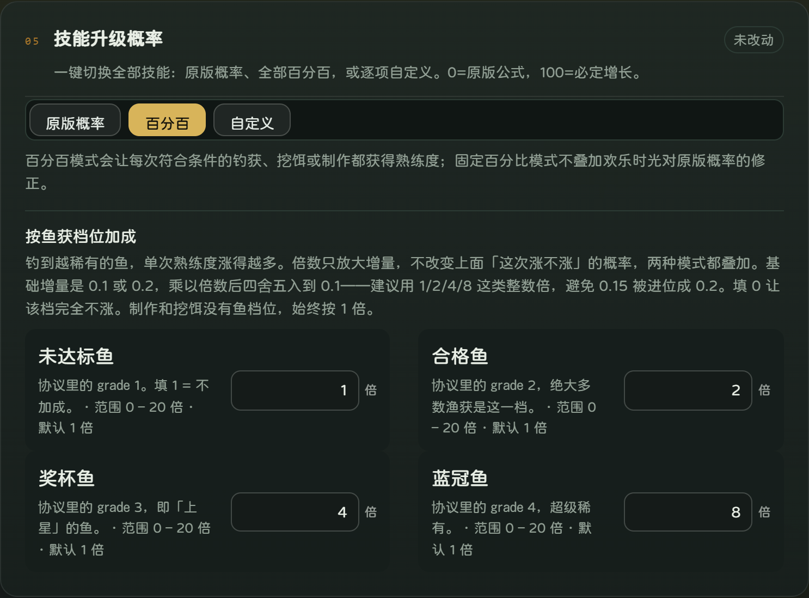

# 鱼获档位熟练度加成

Status: done

## Problem Statement

熟练度增长目前只有「这次涨不涨」一个可调维度：`skill_gain_pct_<cat>` 决定命中概率，
命中后无条件加 0.1 或 0.2。四档鱼获（未达标 / 合格 / 奖杯 / 蓝冠）对熟练度的贡献
完全相同——钓一条蓝冠和钓一条未达标鱼在技能成长上一视同仁。

官方语义上稀有条目更值得记录，而服务端已按 `gradeFromLines` 把每尾鱼判成 1..4 档，
`catch_log.grade` 也在用同一套枚举。缺的只是一个把这些档位接进熟练度结算的旋钮。

## Solution

新增四个 tunable `skill_grade_mult_1`–`skill_grade_mult_4`，在钓获结算时按
`f.Grade` 放大命中后的增量。

档位倍数并入既有的「技能升级概率」区块（05），作为该区块内的第二段「按鱼获档位加成」，
不另起新区块——「涨不涨」与「涨多少」是同一件事的两个维度，分开放会让调参的人来回跳：

- 倍数只乘在**增量**上（0.1 或 0.2），命中概率不受影响，因此原版公式与固定百分比
  两种模式都能叠加，不需要为档位再开一条概率通路。
- `grade <= 0` 表示调用方不区分档位（制作、挖饵、挖饵命令），固定按 1 倍。
- 缺省 1（不变），0 表示该档位完全不涨；负数、NaN、Inf 一律回退 1，避免手改数据库
  把成长意外关掉——与 `skillProficiencyFixedChance` 的容错口径一致。
- 上限由 `catch_settlement` 既有的 `math.Min(gain, profCap-oldSkill)` 钳位兜底，
  倍数再大也不会越过 100%。

### 量化约束

增量写库前会经 `store.QuantizeSkillPoints`（`ROUND(x*10)/10`）。倍数若落在
0.1 的非整数倍上（如 1.5×0.1 = 0.15），会被进位成 0.2，实际效果与配置不符。
后台文案与文档都建议取 1/2/4/8 这类整数倍；实现本身不做取整，保持可解释。

## User Stories

1. 管理员可以只让奖杯与蓝冠加熟练度，普通鱼保持原速。
2. 管理员可以把蓝冠设成 8 倍，让一条稀有鱼抵得上八条普通鱼。
3. 倍数与「百分百」模式叠加：百分百保证每次都涨，倍数决定涨多少。
4. 倍数设为 0 时该档位不涨熟练度，其他档位不受影响。
5. 制作与挖饵的行为完全不变（没有鱼档位）。

## Implementation Decisions

- `internal/gameserver`：`skillProficiencyGainForGradeRoll` / `proficiencyGainForCatchGrade`
  承载带档位的判定；旧的 `skillProficiencyGainForRoll` / `proficiencyGainForCatch`
  保留签名，转调时传 `grade=0`，制作与挖饵链路不受影响。
- `catch_settlement.go` 的结算调用改走 `proficiencyGainForCatchGrade(..., f.Grade, ...)`。
- `internal/admin/api.go`：`skill_grade_mult_` 前缀参数校验为 0–20 的有限数。
- 后台 SPA 在「数值调整 → 经验与奖励」新增「鱼获档位加成」区块，四个输入框默认 1；
  与既有 tunable 共用 savebar 的批量保存，不引入新接口。
- 档位枚举沿用 `achievements.go` 既有注释：1 未达标 / 2 合格 / 3 奖杯 / 4 蓝冠。

## Testing Decisions

- 纯函数：四个档位分别在 0.2 大增量下产出 0.2/0.4/0.8/1.6；未配置档位与 `grade<=0`
  回退 1 倍；负倍数回退 1 倍。
- 概率不变性：倍数 8 且固定概率 50% 时，随机数 0.51 仍判失败、0.49 命中并放大到 1.6。
- 上限：满熟练度下倍数不能绕过 `profCap`。
- 管理 API：越界（-1 / 21 / 非数字）被拒为 400，合法值落库。
- 既有链路回归：制作与钓获的固定百分比测试保持通过。

## Out of Scope

- 不改变命中概率本身，也不新增「按档位改概率」的通路。
- 不覆盖制作、挖饵、烹饪等没有鱼档位的技能大类。
- 不调整四档比例本身（`grade_pct_*`，属「按比例出鱼」规则）。
